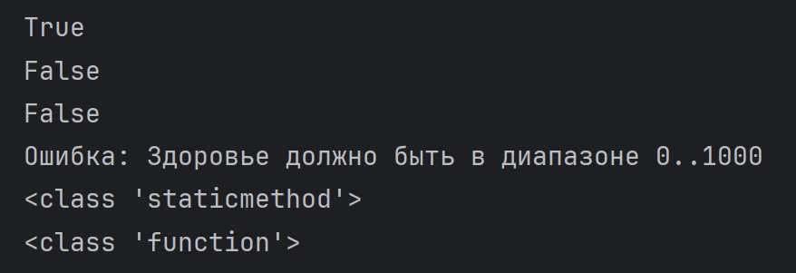

# 4. Статический метод (`@staticmethod`)

## Определение

**Статический метод** — это метод, объявленный внутри класса, но при вызове **не получающий неявного первого аргумента**: ни ссылки на экземпляр (`self`), ни ссылки на класс (`cls`). Формально это обычная функция, помещённая в пространство имён класса и потому доступная как через имя класса, так и через любой его экземпляр.
В отличие от метода экземпляра, статический метод не работает с состоянием конкретного объекта; в отличие от метода класса, он не работает и с состоянием самого класса — если ему нужен атрибут класса, тот указывается явно, по имени класса.

## Ключевые особенности Python и техническая сторона

- **Декоратор, а не ключевое слово.** `@staticmethod` — это встроенный дескриптор, который «отключает» механизм неявной передачи первого аргумента. Запись `@staticmethod` эквивалентна `f = staticmethod(f)`.
- **Вызов от класса и от экземпляра.** Статический метод можно вызывать как `Класс.метод()`, так и `объект.метод()`. В обоих случаях `self` или `cls` не подставляются.
- **Отсутствие доступа к состоянию.** Внутри статического метода нельзя обратиться к `self` или `cls` — это вызовет `NameError`. Если нужен атрибут класса, его указывают явно: `Класс.АТРИБУТ`.
- **Назначение — вспомогательные функции.** Статические методы используют для вспомогательных вычислений, проверок, преобразований, которые логически связаны с классом, но не зависят от конкретного объекта или состояния класса.

## Учебная задача

Создать класс `Hero` (герой RPG) с атрибутами `name`, `health`, `attack`.  
Добавить статический метод `is_valid_health(value)`, который проверяет, что значение здоровья находится в допустимых пределах (например, от 0 до 1000), и возвращает `True` или `False`.  
Продемонстрировать:
1. Вызов статического метода **через класс** до создания экземпляра.
2. Вызов **через экземпляр**.
3. Внутреннее использование статического метода в `__init__` для валидации начального здоровья.
4. Что произойдёт, если попытаться вызвать метод экземпляра без `self` (или наоборот).

## Пример кода

```python
class Hero:
    """Класс, описывающий героя RPG."""

    MAX_HEALTH = 1000  # атрибут класса

    def __init__(self, name, health, attack):
        self.name = name
        self.health = health
        self.attack = attack
        # Статический метод можно вызывать внутри __init__,
        # не создавая дополнительных зависимостей от self.
        if not Hero.is_valid_health(health):
            raise ValueError(f"Здоровье должно быть в диапазоне 0..{Hero.MAX_HEALTH}")

    @staticmethod
    def is_valid_health(value):
        """Проверяет, что здоровье в допустимых пределах (0–1000).

        Это статический метод: он не использует self или cls.
        """
        return 0 <= value <= Hero.MAX_HEALTH


# 1) Вызов через класс — главный признак статического метода.
print(Hero.is_valid_health(500))   # True
print(Hero.is_valid_health(-10))   # False

# 2) Вызов через экземпляр: self НЕ подставляется, сигнатура не «съезжает».
hero = Hero("Артас", 100, 15)
print(hero.is_valid_health(1200))  # False

# 3) Валидация в __init__ не даёт создать некорректный объект.
try:
    Hero("Боря", -5, 10)
except ValueError as e:
    print("Ошибка:", e)            # Ошибка: Здоровье должно быть в диапазоне 0..1000

# 4) Что физически лежит в классе и что возвращается при обращении.
print(type(Hero.__dict__["is_valid_health"]))  # <class 'staticmethod'>
print(type(Hero.is_valid_health))              # <class 'function'>
```

#### Ожидаемый вывод:



#### Важные нюансы реализации:

- Если убрать @staticmethod, вызов Hero.is_valid_health(500) всё ещё сработает (через класс возвращается обычная функция), но вызов hero.is_valid_health(500) упадёт с TypeError, так как экземпляр подставит self первым аргументом.
- Внутри статического метода нельзя написать self.MAX_HEALTH — имени self просто нет. Используйте Hero.MAX_HEALTH.
- Статический метод не хранит состояние. Если появляется необходимость в кэше или изменении состояния класса — это уже задача для метода класса (п. 3) или обычного метода.

## Дополнительные вопросы для изучения
Прочитайте [статью 1](https://realpython.com/ref/builtin-functions/staticmethod/) и [статью 2](https://realpython.com/instance-class-and-static-methods-demystified/) Real Python о статических методах и их отличиях от прочих методов.
Порассуждайте над вопросами:
- Почему в Python статические методы не являются «обязательной церемонией», в отличие от некоторых других языков?
- Приведите пример ситуации, когда использование статического метода может быть неоправданным, и объясните, что лучше использовать вместо него (функцию модуля? метод класса? обычный метод?).
Обоснуйте свой ответ, опираясь на принцип «класс как пространство имён».

**Подсказка для самостоятельного изучения**: обратите внимание на разницу между «пространством имён класса» и «пространством имён модуля» в Python. Когда функция не использует состояние ни объекта, ни класса, но тематически связана с классом, статический метод помогает сгруппировать код. Если же функция вообще не относится к классу, идиоматичнее вынести её в модуль.
