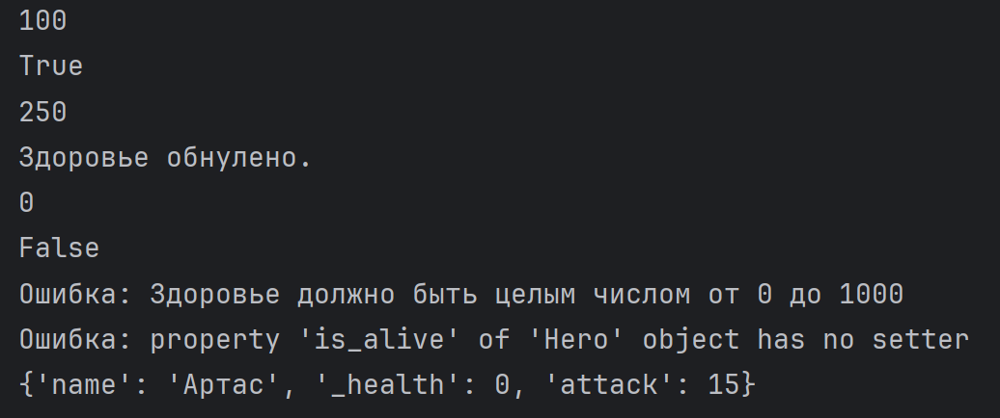

# 5. Аксессоры (getter, setter, deleter). Свойства (`property`)

## Определение

**Аксессоры** — методы, через которые организован доступ к данным объекта: *getter* (получение значения), *setter* (установка значения с проверкой), *deleter* (удаление/сброс значения). Они образуют **управляемый атрибут**: снаружи работа с ним выглядит как обычное обращение к полю (`obj.score`), а внутри выполняется код.
В Python стандартный механизм управляемых атрибутов — встроенный тип **`property`** и одноимённый декоратор. Свойство связывает три операции чтения/записи/удаления одного имени с тремя методами класса и дополнительно хранит строку документации.

## Ключевые особенности Python и техническая сторона

- **`property` — дескрибтор данных.** Объект свойства живёт **в классе**, а не в экземпляре. При чтении `obj.score` интерпретатор находит `score` в классе, видит дескрибтор данных и вызывает его `__get__`, который вызывает ваш getter. При записи `obj.score = 74` вызывается `__set__` → ваш setter. При `del obj.score` — `__delete__` → ваш deleter.
- **Приоритет над `__dict__`.** Поскольку это дескрибтор данных, он имеет приоритет над словарём экземпляра: даже если в `obj.__dict__` окажется ключ `"score"`, чтение всё равно пойдёт через getter. Именно поэтому свойство нельзя «обойти», подсунув одноимённое поле.
- **Значение нужно где-то хранить.** Свойство само по себе хранилищем не является: данные кладут в отдельный атрибут, обычно `_score`. Он попадает в `obj.__dict__` — это легко показать через `vars(obj)`.
- **Порядок декораторов.** `@score.setter` и `@score.deleter` — это методы уже созданного объекта свойства, которые возвращают **новый объект свойства** с тем же именем. Поэтому порядок объявления строго такой: сначала `@property def score`, затем `@score.setter def score`, затем `@score.deleter def score`. Имя метода во всех трёх случаях совпадает с именем свойства.
- **Свойства только для чтения и вычисляемые свойства.** Если определить только getter, атрибут становится доступным только для чтения. Вычисляемые свойства (например, `is_passed`) не хранят значение, а вычисляют его при каждом обращении.
- **Другие языки** В Java/C# геттеры и сеттеры — это методы (`getScore()`/`setScore()`), а в C#, Delphi и JavaScript есть синтаксис свойств (`get`/`set`), ближайший к питоническому `property`. Идея «атрибут снаружи, метод внутри» называется Uniform Access Principle и в Python считается нормой по умолчанию.

## Учебная задача

Создать класс `Hero` (герой RPG) с атрибутами `name`, `health`, `attack`.  
Реализовать свойство `health`:
- геттер возвращает текущее значение `_health`;
- сеттер проверяет, что новое значение является целым числом от 0 до 1000, иначе выбрасывает `ValueError`;
- делитер обнуляет здоровье (устанавливает в 0) и выводит сообщение.

Дополнительно создать свойство `is_alive` (только для чтения), которое возвращает `True`, если здоровье больше 0, и `False` иначе.

Продемонстрировать:
1. Чтение и запись свойства `health`.
2. Работу делитера.
3. Попытку установить некорректное значение (исключение).
4. Что произойдёт, если попытаться изменить свойство только для чтения.
5. Что хранится в `__dict__` экземпляра (с помощью `vars()`).

## Пример кода

```python
class Hero:
    """Класс героя с управляемым атрибутом health."""

    MAX_HEALTH = 1000

    def __init__(self, name, health, attack):
        self.name = name
        # Используем сеттер для первичной валидации
        self.health = health
        self.attack = attack

    @property
    def health(self):
        """Геттер: возвращает текущее здоровье."""
        return self._health

    @health.setter
    def health(self, value):
        """Сеттер: проверяет корректность значения."""
        if not isinstance(value, int) or not (0 <= value <= Hero.MAX_HEALTH):
            raise ValueError(f"Здоровье должно быть целым числом от 0 до {Hero.MAX_HEALTH}")
        self._health = value

    @health.deleter
    def health(self):
        """Делитер: обнуляет здоровье."""
        print("Здоровье обнулено.")
        self._health = 0

    @property
    def is_alive(self):
        """Вычисляемое свойство только для чтения."""
        return self._health > 0


# Демонстрация
hero = Hero("Артас", 100, 15)
print(hero.health)        # 100 (работает геттер)
print(hero.is_alive)      # True

hero.health = 250         # работает сеттер
print(hero.health)        # 250

del hero.health           # работает делитер
print(hero.health)        # 0
print(hero.is_alive)      # False

# Попытка установить некорректное значение
try:
    hero.health = -50
except ValueError as e:
    print(f"Ошибка: {e}")

# Попытка изменить свойство только для чтения
try:
    hero.is_alive = False
except AttributeError as e:
    print(f"Ошибка: {e}")

# Что хранится в __dict__?
print(vars(hero))         # {'name': 'Артас', '_health': 0, 'attack': 15}
```

#### Ожидаемый вывод:



#### Важные нюансы реализации:

- Бесконечная рекурсия. Строка self.health = value внутри сеттера health снова вызовет тот же сеттер → RecursionError. Хранить значение нужно в другом имени (_health). Это ошибка №1 у студентов.

- __init__ должен идти через свойство (self.health = health), иначе проверка при создании объекта не выполнится.

- Свойство ≠ хранилище. vars(hero) показывает _health, а не health. Это отличная демонстрация в Python Tutor.

- isinstance(True, int) → True. Если по условию задачи логическое значение недопустимо, проверку типа надо усилить: type(value) is int.

- Делитер не обязан удалять атрибут. В примере он выполняет сброс состояния — это законный и часто более удобный сценарий, чем del self._health (после которого getter упадёт с AttributeError).

## Вопросы для дополнительного изучения
Прочитайте [раздел о property](https://docs.python.org/3/library/functions.html#property) в документации Python и/или [статью Real Python](https://realpython.com/python-property/).
Поразмышляйте над вопросами:

- Почему в Python рекомендуется начинать с обычных атрибутов, а не с геттеров и сеттеров, и в какой момент стоит заменить атрибут на property?

- Как вы думаете, какие проблемы могло бы вызвать повсеместное использование property там, где достаточно обычного атрибута?
Обоснуйте свой ответ, опираясь на принцип «атрибут снаружи, логика внутри».

**Подсказка для самостоятельного изучения**: обратите внимание на разницу между «свойством» и «обычным атрибутом» с точки зрения производительности и читаемости кода. Когда логика проверки или вычисления действительно нужна, property оправдан. Когда её нет, обычный атрибут проще и понятнее.
