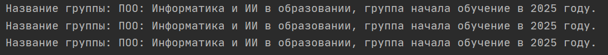

#### Определение
**Инкапсуляция** - это принцип, согласно которому внутреннее устройство сущностей объединяется в специальной «оболочке» и скрывается от вмешательств извне. Доступ к объектам возможен через специальные открытые методы, а напрямую обратиться к их содержимому нельзя.
Инкапсуляцию также описывают как принцип разделения логики и поведения. **Логика** - то, как что-то устроено внутри, а **поведение** - то, как оно взаимодействует с другими сущностями.
#### Пример использования

```python
class Group:  
    def __init__(self, name, year):  
        self.__name = name  # устанавливаем название группы  
        self.__year = year  # устанавливаем год начала обучения  
  
    def group_info(self):  
        print(f"Название группы: {self.__name}, группа начала обучение в {self.__year} году.")  
  
  
myGroup = Group("ПОО: Информатика и ИИ в образовании",2025)  
myGroup.group_info()  
  
myGroup.name = "ИВТ: какие-то программисты"  
myGroup.group_info()  
  
myGroup.__name = "ИВТ: какие-то программисты"  
myGroup.group_info()
```

Результат запуска программы будет следующий:


