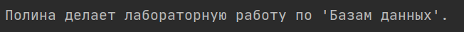

#### Определение
**Наследование** - концепция, которая позволяет создавать новый класс на основе уже существующего класса.
Ключевыми понятиями наследования являются **подкласс** и **суперкласс**. Подкласс наследует от суперкласса все публичные атрибуты и методы. Суперкласс также называют базовым (base class) или родительским (parent class), а подкласс - производным (derived class) или дочерним (child class).
#### Пример использования
```python
class Human:  
    def __init__(self, name):  
        self.__name = name  # устанавливаем имя  
  
    @property  
    def name(self):  
        return self.__name  
  
    def display_info(self):  
        print(f"Этого человека зовут {self.__name} ")  
  
  
class Student(Human):  # указываем в скобках родительский класс  
  
    def study_database(self):  
        print(f"{self.name} делает лабораторную работу по 'Базам данных'.")  
  
  
friend = Student('Полина')  
friend.study_database()
```

Результат запуска программы будет следующий:



Этот результат показывает нам, что объект `polina` хоть и создан как объект класса `Student`, имеет атрибут `name` из класса `Human`, так как класс `Human` родительский для `Student`. То есть `Student` унаследовал этот атрибут от своего родительского класса.
При этом, у `Student` есть свой собственный метод `study_database`, поэтому для `polina` он тоже доступен.