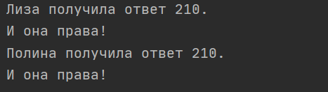
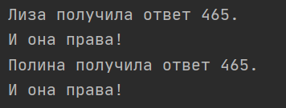

#### Определение
**Интерфейс** - это контракт на реализацию определенного поведения.
Объект, реализуя интерфейс, гарантирует наличие этого поведения. Как следствие, объекты, не связанные друг с другом никакими отношениями, включая отношения наследования, могут предоставлять собственную реализацию требуемого поведения, а объект-потребитель сможет их единообразно и непротиворечиво использовать.

Само понятие интерфейса очень плотно связано с *полиморфизмом*, но при этом важно отметить, что интерфейс конкретно закрепляет какое-либо поведение (например, что метод `go` обязательно присутствует).

#### Пример использования
В языке python можно реализовать интерфейс двумя способами: при помощи `Protocol`(здесь же уже знакомая нам "утиная типизация") или при помощи абстрактных классов `ABC`.
Рассмотрим оба варианта:

1. `Protocol`
```python
from typing import Protocol  
  
  
class Student(Protocol):  
  
    @property  
    def name(self) -> str:  
        pass  
  
    def solve(self, n) -> int:  
        pass  
  
  
class Mathy:  
    def __init__(self, name: str):  
        self.__name = name  
  
    @property  
    def name(self) -> str:  
        return self.__name  
  
    def solve(self, n):  # находит сумму всех чисел до n через формулу  
        s = n * (n + 1) // 2  
        print(f"{self.name} получила ответ {s}.")  
        return s  
  
  
class Hardworking:  
    def __init__(self, name: str):  
        self.__name = name  
  
    @property  
    def name(self) -> str:  
        return self.__name  
  
    def solve(self, n):  # тоже находит сумму всех чисел до n, но через пересчёт  
        s = 0  
        for i in range(n + 1):  
            s = s + i  
        print(f"{self.name} получила ответ {s}.")  
        return s  
  
  
def is_true(student: Student,  
            n):  # здесь мы и используем интерфейс, который ожидает что ЛЮБОЙ студент умеет решать задачу  
    i = student.solve(n)  
    if i == sum(range(n + 1)):  
        print('И она права!')  
    else:  
        print('Но она ошиблась.')  
  
  
friend = Hardworking('Полина')  
me = Mathy('Лиза')  
  
is_true(me, 20)  
is_true(friend, 20)
```

Результат запуска программы будет следующий:



В данном случае классы `Mathy` и  `Hardworking` не связаны со `Student` напрямую при помощи наследования, но при этом в функции `is_true` ожидается что объекты этих классов будут подходить под наш интерфейс.

2. `ABC`
```python
from abc import ABC, abstractmethod  
  
  
class Student(ABC):  
  
    def __init__(self, name: str):  
        self.__name = name  
  
    @property  
    def name(self) -> str:  
        return self.__name  
  
    @abstractmethod  # здесь и "заключается контракт" - каждый студент обязан уметь решать задачи  
    def solve(self, n: int) -> int:  
        pass  
  
  
class Mathy(Student):  
  
    def solve(self, n: int) -> int:  
        s = n * (n + 1) // 2  
        print(f"{self.name} получила ответ {s}.")  
        return s  
  
  
class Hardworking(Student):  
  
    def solve(self, n: int) -> int:  
        s = 0  
        for i in range(n + 1):  
            s += i  
        print(f"{self.name} получила ответ {s}.")  
        return s  
  
  
def is_true(student: Student, n: int) -> None:  
    i = student.solve(n)  
    if i == sum(range(n + 1)):  
        print("И она права!")  
    else:  
        print("Но она ошиблась.")  
  
  
friend = Hardworking("Полина")  
me = Mathy("Лиза")  
  
is_true(me, 30)  
is_true(friend, 30)
```

Результат запуска программы будет следующий:



В данном случае классы `Mathy` и  `Hardworking` прямо наследуются от `Student` напрямую при помощи наследования. Таким образом метод `solve` проверяется более жёстко.


