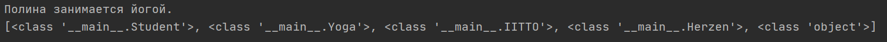
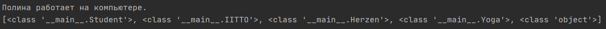
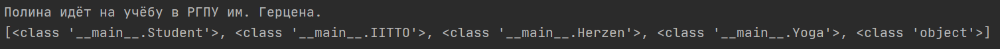

#### Определение
**Множественное наследование** - концепция, которая позволяет классам наследовать не только от одного родительского класса, а от нескольких.

Важно отметить, что при использовании множественного наследования могут возникнуть сложности (например, метод с одинаковым именем существует и в одном родителе и в другом). Для разрешения подобных конфликтов существует MRO:
Python выстраивает все классы-родители в одну плоскую очередь, используя три простых правила:
1. **Сначала сам класс:** Сперва метод ищется в самом дочернем классе.
2. **Слева направо:** Затем родители проверяются строго в том порядке, в каком они записаны в скобках.
3. **Общий предок - в самом конце:** Если у родителей есть общий базовый класс, Python проверит его только после того, как обойдет всех прямых родителей.
#### Пример использования
```python
class Herzen:  
  
    def __init__(self, name: str):  
        self.__name = name  
  
    @property  
    def name(self) -> str:  
        return self.__name  
  
    def go_study(self):  
        print(f"{self.__name} идёт на учёбу в РГПУ им. Герцена.")  
  
  
class IITTO(Herzen):  
    def do(self):  
        print(f"{self.name} работает на компьютере.")  
  
  
class Yoga:  
    def do(self):  
        print(f"{self.name} занимается йогой.")  
  
  
class Student(Yoga, IITTO):  
    pass  
  
  
friend = Student('Полина')  
friend.do()
print(Student.mro())
```

Результат запуска программы будет следующий:



Разберём результат. В данном случае выполнился метод `do` из класса `Yoga`, так как этот класс был "самым левым" в списке родительских классов. Ниже также выведено актуальное MRO, где можно посмотреть порядок наследования.
Также стоит обратить внимание, что в классе `Yoga` атрибута `name` нет вообще - он подтягивается из других наследуемых классов.

Если же мы поменяем наследуемые классы местами, например так:
```python
...
 
class Student(IITTO, Yoga):  
    pass  
  
  
friend = Student('Полина')  
friend.do()
print(Student.mro())
```

То результат запуска программы будет следующий:



На этот раз класс `IITTO` указан "левее" чем `Yoga`, поэтому метод `do` используется из класса `IITTO`. 

Также, мы можем выполнить следующее:
```python
...
 
friend.go_study()  
print(Student.mro())
```



Этот результат свидетельствует о том, что `Student` наследует свойства даже от `Herzen`, несмотря на то что напрямую данное наследование не указано.