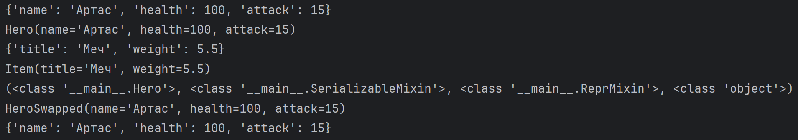

# 11. Примесь (mixin)

## Определение

**Примесь (mixin)** — класс, предназначенный не для создания собственных объектов, а для **добавления готового поведения** другим классам через наследование (как правило, множественное). Примесь описывает *одну узкую возможность* («умеет превращаться в JSON», «умеет печатать себя», «умеет писать журнал») и подключается к классу-хосту в списке базовых классов.

Примесь — не «вид объекта» и не полноценный родитель: она не образует отношение «является» (*is-a*), а выражает отношение «умеет» (*can-do*). Формально в Python это обычный класс — никакого отдельного синтаксиса у примесей нет; примесью его делают **назначение, оформление и способ использования**.

## Ключевые особенности Python и техническая сторона

- **MRO (C3-линеаризация).** При объявлении `class Student(JSONMixin, ReprMixin)` Python вычисляет линеаризованный порядок классов — `Student.__mro__`. Поиск любого атрибута/метода идёт по этой цепочке слева направо до первого совпадения. Поэтому **порядок базовых классов — часть семантики**: примеси принято ставить **левее** основного базового класса, чтобы их методы могли переопределить его методы.
- **Примесь видит хост через `self`.** Метод примеси выполняется с тем же `self`, что и метод хоста, поэтому `self.name`, `vars(self)`, `type(self).__name__` и вызовы `self.to_dict()` работают так, как будто код написан в самом хосте. Это и есть механизм «подмешивания»: никакого копирования кода не происходит.
- **Контракт вместо состояния.** Примесь либо обращается к атрибутам, которые обещает хост, либо вызывает **метод-зацепку** (hook), который хост обязан реализовать (`to_dict()` в примере ниже). Такое «ожидаемое поведение» удобно оформлять как интерфейс (п. 9) или просто документировать в docstring примеси.
- **Кооперативный `super()`.** Если примесь переопределяет метод, она обычно не «затирает» реализацию хоста, а вызывает `super().method()`. Важно: `super()` — это **не «родительский класс»**, а *следующий класс в MRO конкретного объекта*. Поэтому один и тот же `super().save()` в примеси попадёт в разные реализации в зависимости от того, в какой класс её подмешали.
- **Отсутствие специального синтаксиса.** В Python примесь — это соглашение, а не конструкция языка (сравните: `trait` в PHP/Scala, `module` + `include` в Ruby). Множественное наследование разрешено, поэтому примеси подключаются напрямую, без интерфейсных обёрток; за корректность порядка отвечает C3-MRO.
- **Культурный контекст.** Идея примесей пришла из Lisp/CLOS и Flavors, а сегодня прямо поддержана в Ruby (модули), Scala и PHP (трейты); в Java и C# близкую роль играют `default`-методы интерфейсов. Python выбрал самый «лёгкий» путь — обычный класс плюс дисциплина проектирования.

## Учебная задача

Создать две примеси:
- `SerializableMixin` с методом `to_dict()`, который возвращает словарь с атрибутами объекта;
- `ReprMixin` с методом `__repr__`, который выводит читаемое представление объекта в формате `ClassName(поле=значение, ...)`.

Затем создать два несвязанных класса:
- `Hero` (герой) с атрибутами `name`, `health`, `attack`;
- `Item` (предмет) с атрибутами `title`, `weight`.

Оба класса должны наследовать обе примеси (порядок: сначала примеси, потом — если есть — основной класс).  
Продемонстрировать:
1. Работу `to_dict()` и `__repr__` для обоих классов.
2. Порядок разрешения методов (MRO) с помощью `__mro__`.
3. Что произойдёт, если поменять порядок базовых классов (например, `class Hero(ReprMixin, SerializableMixin)` — изменится ли что-то?).

## Пример кода

```python
class SerializableMixin:
    """Примесь, добавляющая метод to_dict()."""

    def to_dict(self):
        """Возвращает словарь с публичными атрибутами экземпляра."""
        return {key: value for key, value in vars(self).items()
                if not key.startswith('_')}


class ReprMixin:
    """Примесь, добавляющая читаемое представление."""

    def __repr__(self):
        fields = ", ".join(f"{k}={v!r}" for k, v in vars(self).items()
                           if not k.startswith('_'))
        return f"{type(self).__name__}({fields})"


class Hero(SerializableMixin, ReprMixin):
    """Герой RPG."""

    def __init__(self, name, health, attack):
        self.name = name
        self.health = health
        self.attack = attack


class Item(SerializableMixin, ReprMixin):
    """Предмет инвентаря."""

    def __init__(self, title, weight):
        self.title = title
        self.weight = weight


# Демонстрация
hero = Hero("Артас", 100, 15)
item = Item("Меч", 5.5)

print(hero.to_dict())   # {'name': 'Артас', 'health': 100, 'attack': 15}
print(repr(hero))       # Hero(name='Артас', health=100, attack=15)

print(item.to_dict())   # {'title': 'Меч', 'weight': 5.5}
print(repr(item))       # Item(title='Меч', weight=5.5)

# Порядок разрешения методов
print(Hero.__mro__)
# (<class '__main__.Hero'>, <class '__main__.SerializableMixin'>,
#  <class '__main__.ReprMixin'>, <class 'object'>)

# Если поменять порядок базовых классов:
class HeroSwapped(ReprMixin, SerializableMixin):
    def __init__(self, name, health, attack):
        self.name = name
        self.health = health
        self.attack = attack

h2 = HeroSwapped("Артас", 100, 15)
print(repr(h2))         # HeroSwapped(name='Артас', health=100, attack=15)
print(h2.to_dict())     # {'name': 'Артас', 'health': 100, 'attack': 15}
# В данном случае поведение не изменилось, так как методы не конфликтуют.
```

#### Ожидаемый вывод:



#### Важные нюансы реализации:

- Порядок базовых классов = поведение. Если бы обе примеси определяли метод с одинаковым именем, победила бы та, что стоит левее в MRO. В нашем примере методы разные, поэтому перестановка не влияет на результат.
- super() в примеси требует продолжения цепочки. Если подмешать примесь с super().save() в класс без метода save, получим AttributeError. Контракт примеси надо документировать.
- Не заводите в примеси обязательный __init__. Иначе придётся вручную согласовывать вызовы конструкторов по всей цепочке MRO — типичный источник ошибок «объект не инициализирован».
- vars(self) не видит свойства. Значения, доступные только через property (п. 5), нужно перечислять явно, если они должны попасть в сериализацию.

## Вопросы для дополнительного изучения
Прочитайте статьи о MRO (например, [раздел в документации Python](https://docs.python.org/3/tutorial/classes.html#multiple-inheritance) или классический [текст M. Simionato](https://www.python.org/download/releases/2.3/mro/) )
Порассуждайте над вопросами:

- Почему порядок базовых классов в Python влияет на поведение программы? Приведите пример, когда перестановка примеси и основного класса приводит к ошибке или изменению поведения.
- Как вы думаете, какие проблемы могут возникнуть, если две примеси определяют метод с одинаковым именем, и как этого избежать?
Обоснуйте свой ответ, опираясь на алгоритм C3-линеаризации.

Подсказка для самостоятельного изучения: обратите внимание на то, что super() в примеси — это не «родительский класс», а следующий класс в MRO конкретного объекта. Понимание этого помогает проектировать кооперативные примеси, которые не ломают цепочку вызовов.
