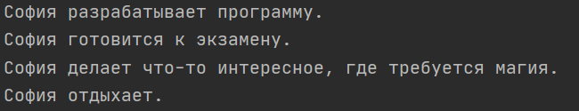

#### Определение
**Полиморфизм** - это механизм в ООП, позволяющий создавать несколько методов или операторов с одинаковым именем, но разными параметрами.
В каком-то смысле, это тот же полиморфизм, но внутри одного класса.
#### Пример использования
В python нет прямого способа реализовать перегрузку, так как это динамический язык программирования, и создавая метод с таким же названием python каждый раз будет "перезапоминать" новые инструкции.

Но можно реализовать его "вспомогательными" способами. Рассмотрим их.

1. Значения по умолчанию
```python
class Student:  
  
    def __init__(self, name: str):  
        self.__name = name  
  
    def do(self, item=None):  
        if item == 'ручка':  
            print(f"{self.__name} пишет конспект.")  
        elif item == 'ноутбук':  
            print(f"{self.__name} разрабатывает программу.")  
        elif item == 'учебник':  
            print(f"{self.__name} готовится к экзамену.")  
        elif item:  
            print(f"{self.__name} делает что-то интересное, где требуется {item}.")  
        else:  
            print(f"{self.__name} отдыхает.")  
  
  
student = Student("София")  
student.do('ноутбук')  
student.do('учебник')  
student.do('магия')  
student.do()
```

Результат запуска программы будет следующий:



Таким образом, меняя входные аргументы (их может быть сколько угодно) мы реализуем перегрузку.
Минус заключается в том, что возникает большое количество `if/else`, и в принципе логика метода может очень сильно усложниться.
