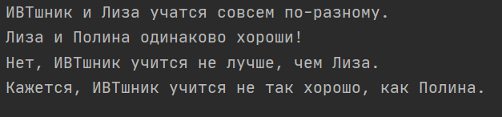

#### Определение
**Полиморфизм** - это механизм в ООП, позволяющий создавать несколько методов или операторов с одинаковым именем, но разными параметрами.
В каком-то смысле, это тот же полиморфизм, но внутри одного класса.
#### Пример использования
В python нет прямого способа реализовать перегрузку, так как это динамический язык программирования, и создавая метод с таким же названием python каждый раз будет "перезапоминать" новые инструкции.

Но можно реализовать его "вспомогательными" способами. Рассмотрим их.

1. Значения по умолчанию
```python
class Student:  
  
    def __init__(self, name: str):  
        self.__name = name  
  
    def do(self, item=None):  
        if item == 'ручка':  
            print(f"{self.__name} пишет конспект.")  
        elif item == 'ноутбук':  
            print(f"{self.__name} разрабатывает программу.")  
        elif item == 'учебник':  
            print(f"{self.__name} готовится к экзамену.")  
        elif item:  
            print(f"{self.__name} делает что-то интересное, где требуется {item}.")  
        else:  
            print(f"{self.__name} отдыхает.")  
  
  
student = Student("София")  
student.do('ноутбук')  
student.do('учебник')  
student.do('магия')  
student.do()
```

Результат запуска программы будет следующий:


Таким образом, меняя входные аргументы (их может быть сколько угодно) мы реализуем перегрузку.
Минус заключается в том, что возникает большое количество `if/else`, и в принципе логика метода может очень сильно усложниться.

2. Значения по умолчанию
```python
from functools import singledispatchmethod  
  
  
class Student:  
    def __init__(self, name: str):  
        self.__name = name  
  
    def do(self, item=None):  
        self._do_dispatch(item)  
  
    @singledispatchmethod  
    def _do_dispatch(self, item):  
        print(f"Хм, {item}? {self.__name} не может понять что с этим делать...")  
  
    @_do_dispatch.register(type(None))  
    def _(self, item):  
        print(f"Эмм..? {self.__name} ничего не видит.")  
  
    @_do_dispatch.register  
    def _(self, item: int):  
        print(f"О, '{item}'! {self.__name} видит число, это же математика!")  
  
    @_do_dispatch.register  
    def _(self, item: str):  
        print(f"О, '{item}'! {self.__name} видит строчку, её можно записать в тетрадь.")  
  
  
student = Student("София")  
student.do('абракадабра')  
student.do(1208)  
student.do([1, 2, 3])  
student.do()
```

Результат запуска программы будет следующий:


Данная программа выглядит "красивее", но существенный минус заключается в том что `singledispatch` способен принимать только один аргумент как инструмент "переключения", поэтому полноценно реализовать перегрузку без использования дополнительных библиотек не получится.

Зато, у `python` есть одна очень интересная и удобная возможность - перегрузка операторов!
Перегрузка операторов (Operator Overloading) - это возможность научить стандартные знаки (`+`, `-`, `*`, `==`, `<`, `in` и даже `len()`) работать по-другому с объектами разных классов. Реализуется это через магические методы, например так:
```python
class Student:  
    def __init__(self, name: str, points: int):  
        self.__name = name  
        self.points = points  
  
    def __eq__(self, other):  
        if isinstance(other, Student):  
            if self.points == other.points:  
                return f"{self.__name} и {other.__name} одинаково хороши!"            return f"{self.__name} и {other.__name} учатся совсем по-разному."  
    def __ne__(self, other):  
        if isinstance(other, Student):  
            if self.points != other.points:  
                return f"Не стоит приравнивать то как учится {self.__name} и {other.__name}."  
            return f"И {self.__name}, и {other.__name} учатся одинаково."  
    def __lt__(self, other):  
        if isinstance(other, Student):  
            if self.points < other.points:  
                return f"Кажется, {self.__name} учится не так хорошо, как {other.__name}."  
            return f"Нет, {self.__name} учится не хуже, чем {other.__name}."  
  
    def __gt__(self, other):  
        if isinstance(other, Student):  
            if self.points > other.points:  
                return f"Видимо, {self.__name} учится лучше, чем {other.__name}."  
            return f"Нет, {self.__name} учится не лучше, чем {other.__name}."  
  
  
s1 = Student("ИВТшник", 7)  
s2 = Student("Лиза", 82)  
s3 = Student("Полина", 82)  
  
print(s1 == s2)   
print(s2 == s3)    
print(s1 > s2)    
print(s1 < s3)
```

И результат будет следующий:



Таким образом, можно, например, полностью переписать под свои классы все базовые операторы, для более удобной работы с объектами.
Однако важно отметить что приведённый выше код - дурной тон, который может повлечь кучу ошибок. Всё дело в том что от операторов сравнения (`==`, `<`, `>`) все программисты и сам python (например, функции `sorted()`, `min()`, `max()`) ожидают строго логический ответ `True` или `False`. А код возвращает строки, что очень нехорошо в реальном коде (но приемлемо в качестве примера.)
