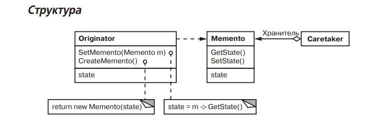

!Черновик
#### Определение
**Хранитель** (он же снимок, в оригинале - memento, он же иногда token) - поведенческий паттерн проектирования, который не нарушая инкапсуляции фиксирует и выносит за пределы объекта его внутреннее состояние так, чтобы позднее можно было восстановить в нем объект.
#### Для чего нужен?
При разработке программы иногда возникает необходимость сохранить текущее состояние какого-нибудь объекта, чтобы иметь возможность в последствии "откатиться" до старой версии. С подобным мы встречаемся достаточно часто: использование Ctrl+Z в Word при написании документов, загрузка сохранения в игре, отмена покупки в онлайн-магазине, если на карте недостаточно средств и так далее. Во всех этих ситуациях нет возможности просто "сделать обратное действие" чтобы вернуться к тому что было, так как совершается сразу несколько сложных действий единым блоком. Поэтому намного проще создать отдельный *хранитель* состояний, который будет запоминать как выглядел наш объект до изменений. А при запросе он сразу выдаст нам все характеристики объекта, благодаря которым можно будет восстановить нужную версию.  
#### Зачем отдельный хранитель?
Обычно объекты частично или полностью инкапсулируют своё состояние, чтобы не было ненужных вмешательств. Таким образом сохранить состояние объекта извне становится невозможно. Если сделать состояние открытым, то это нарушит принцип инкапсуляции и поставит под угрозу надёжность программы.  
Поэтому, вместо того чтобы пытаться сделать снимок извне, хранитель поручает эту задачу самому объекту, ведь ему доступны все свои закрытые поля.  Объект сам делает снимок и передает его хранителю на хранение. При этом такой снимок полностью доступен для своего *создателя* (класс, чьё состояние мы сохраняем) и частично доступен для *опекуна* (класс который хранит только информацию о снимках, не залезая в подробности состояния объекта).

#### Как это работает?

Весь паттерн можно поделить на три роли:
1. **Создатель, он же Хозяин$^1$ (`Originator`)** — это сам наш рабочий объект (редактор текста, конструктор расписания). Только он знает, как устроены его внутренности и какие именно данные нужно сохранить, чтобы потом ожить в том же виде.
2. **Хранитель или Снимок (`Memento`)** — это запечатанный конверт с фотографией состояния на конкретный момент времени. Снимок абсолютно пассивен: он ничего не вычисляет, а просто бережно держит внутри изолированную копию данных.
3. **Опекун, он же Посыльный$^1$ (`Caretaker`)** — это менеджер истории (например, стопка черновиков или кнопка «Назад»). Его задача — вовремя попросить у Хозяина конверт, положить его в стопку и при необходимости достать обратно.

%%
($^1$ - так названы роли в книге "Приемы объектно-ориентированного проектирования. Паттерны проектирования.", Гамма Э., Хелм Р., Джонсон Р., Влиссидес Дж.) 
%%
Два интерфейса: секрет «чёрного ящика»

В книге «Банды четырёх» подчёркивается ключевая фишка Хранителя — у него как бы **два лица (два интерфейса)**:

- **Для Опекуна (узкий интерфейс):** Опекун видит снимок исключительно как непрозрачный «чёрный ящик». Он не может открыть конверт, прочитать или подправить данные внутри. Он умеет только передавать этот объект другим и хранить у себя в списке.
- **Для Создателя (широкий интерфейс):** Создатель, который сам же и породил этот снимок, имеет полный доступ к его содержимому (`GetState()`), чтобы достать данные и восстановить себя.

Как выглядит цикл работы по шагам (на примере схемы):

1. **Момент сохранения:** Пользователь нажимает «Сохранить». Опекун говорит Создателю: _«Сделай снимок»_ (`CreateMemento()`). Создатель копирует свои текущие внутренние данные, упаковывает их в новый объект `Memento` и отдаёт Опекуну. Опекун кладёт этот «чёрный ящик» себе в историю (`Save(m)`).
2. **Работа и поломка:** Создатель продолжает жить своей жизнью — данные в нём меняются, перезаписываются или удаляются. При этом внутри сохранённого `Memento` лежит независимая копия, поэтому архивный снимок не портится.
3. **Момент отката (Undo):** Пользователь понимает, что пошёл не туда, и жмёт «Отмена». Опекун достаёт из своей истории последний снимок (`Undo()`) и возвращает его Создателю со словами: _«Восстановись вот из этого»_ (`SetMemento(m)`). Создатель открывает свой же снимок, достаёт оттуда старые данные (`GetState()`) и возвращает себя в прежнее состояние.

**Итог:** Создатель остаётся защищённым (никто не лезет в его внутренности), Опекун остаётся простым и универсальным (ему всё равно, что именно он хранит — текст, расписание или настройки игры), а пользователь получает надёжную машину времени.

---

Как тебе такой формат и подача? Насколько легко читается для студентов 2 курса?

Если такое пояснение отлично ложится в теорию, скажи:

- Нужно ли что-то **сократить, дополнить или переформулировать** (например, добавить конкретный пример из нашей задачи с расписанием прямо в текст)?
- Или уже переходим к **написанию самой задачи** про расписание (`Schedule`, `ScheduleMemento`, `DraftHistory`) и тестов для `index.html`?

*Пример*

*Задание*
Инструмент:
https://github.com/lisater/tryLearn
Идея:

1. В чем проблема без «Хранителя»?

Представь, что у тебя есть класс `Schedule` (Расписание), а внутри него — сложная и закрытая кухня: приватный словарь пар по дням, список занятых аудиторий и счетчик часов нагрузки.  
Теперь методисту нужно сохранить черновик расписания в отдельный класс `Archive` (Архив черновиков), чтобы потом к нему вернуться.

Если делать «в лоб» без паттерна, у тебя два плохих пути:

- **Путь А (нарушение инкапсуляции):** класс `Archive` лезет прямо внутрь `Schedule`, читает его приватные поля (`schedule._slots`, `schedule._rooms`), сам их копирует и складывает к себе. Если завтра ты поменяешь структуру внутри `Schedule` (например, вместо словаря сделаешь список объектов `Lesson`), код архива сломается.
- **Путь Б (невозможность отменить массовую чистку):** если использовать паттерн «Команда» (запоминать отдельные действия), то после вызова `clear_day("Пн")` (удалить все пары понедельника) или `swap_days("Пн", "Вт")` придется писать сложную логику для восстановления каждой удаленной пары, её аудитории и времени.

2. Как это решает «Хранитель»

В паттерне «Хранитель» сам объект `Schedule` делает свой «фотоснимок» (`ScheduleMemento`), запечатывает его в конверт и отдает в `Archive`:

1. **`Archive` (Опекун) ничего не знает о том, как устроено расписание.** Для него `ScheduleMemento` — это просто непрозрачный объект с меткой времени или названием черновика (например, `"Черновик до правки пятницы"`). Он не может случайно изменить там пару или сломать аудиторию.
2. **Ветвление версий (главное отличие от обычного `Ctrl+Z` в Word):** в отличие от простого шага назад, методист может сохранить **три разных варианта** расписания («Вариант без окон», «Вариант с выходным в субботу», «Финальный»), покрутить каждый из них, а потом одним вызовом `schedule.restore(draft_1)` мгновенно вернуть всю сетку на любой выбранный черновик.

Как упаковать это в задачу, чтобы студент это прочувствовал

Сделай в классе `Schedule` два приватных поля (начинающихся с `_`, например `_slots` и `_version_note`) и метод `clear_day(day)` (полная очистка дня).  
Тогда студент увидит:

- Внешний класс `DraftHistory` работает **только** с объектами `ScheduleMemento` и вообще не трогает `_slots`.
- При создании снимка нельзя просто передать `self._slots` по ссылке — иначе после `clear_day("Пн")` черновик тоже очистится (классическая ловушка в Python, которую мы поймаем автотестом!).

